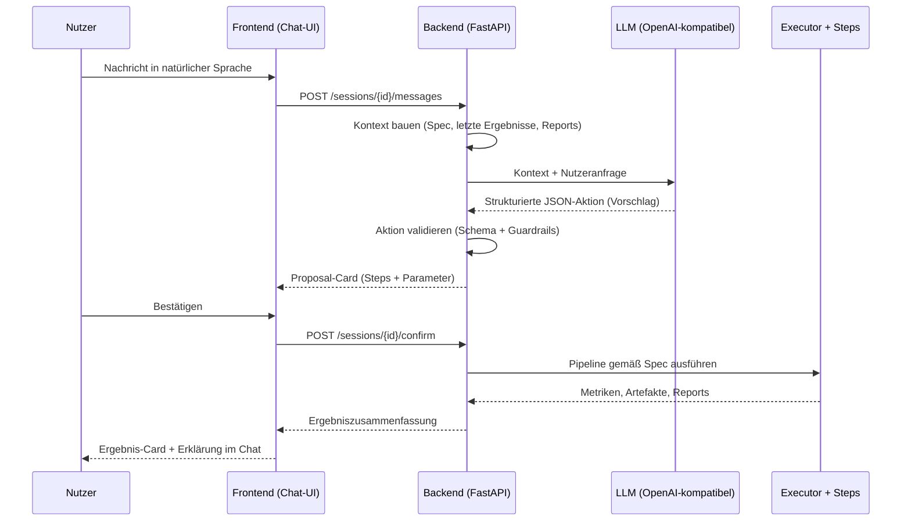

# gysi-ml

**Gysi** ist ein konversationeller ML-Assistent. Nutzerinnen und Nutzer beschreiben in natürlicher Sprache, was sie mit einem Datensatz (speziell dem Bike-Sharing-Datensatz) tun möchten z. B. fehlende Werte behandeln, Features encodieren oder ein Modell trainieren. Ein LLM übersetzt diese Anfragen ausschließlich in **strukturierte Aktionen (JSON)**. Es führt selbst niemals Code aus. Alle Berechnungen laufen deterministisch und nachvollziehbar im Python-Backend.

Das zentrale Architekturprinzip ist die **strikte Trennung von Planung und Ausführung**: Das LLM orchestriert und erklärt, das Backend entscheidet, validiert und rechnet.

## Inhaltsverzeichnis

- [Kernprinzipien](#kernprinzipien)
- [Systemkonzept: Rollenverteilung](#systemkonzept-rollenverteilung)
- [Architektur & Datenfluss](#architektur--datenfluss)
- [Was kann Gysi?](#was-kann-gysi)
  - [Preprocessing-Steps](#preprocessing-steps)
  - [Modeling-Steps](#modeling-steps)
  - [Erzeugte Artefakte](#erzeugte-artefakte)
  - [Sicherheits- und Qualitäts-Features](#sicherheits--und-qualitäts-features)
  - [Frontend-Tabs & Slash-Commands](#frontend-tabs--slash-commands)
- [Voraussetzungen](#voraussetzungen)
- [Setup](#setup)
- [Konfiguration (`backend/.env`)](#konfiguration-backendenv)
- [Starten](#starten)
- [Tests](#tests)
- [Projektstruktur](#projektstruktur)
- [API-Endpunkte](#api-endpunkte)
- [Technologie-Stack](#technologie-stack)
- [Dokumentation](#dokumentation)
- [Konventionen & Mitarbeit](#konventionen--mitarbeit)

## Kernprinzipien

- **Backend kontrolliert den Ablauf** — das LLM wird angefragt, nicht umgekehrt
- **LLM führt keinen Code aus** und verändert kein Framework direkt
- **LLM erfindet keine neuen Bausteine** — es darf ausschließlich Aktionen aus einem vordefinierten Katalog verfügbarer Steps verwenden
- **Versionierte Pipeline-Spec** (JSON) als Quelle der Wahrheit für den gesamten Systemzustand
- **Proposal → Confirm** — jeder Vorschlag des LLM muss vom Nutzer explizit bestätigt werden, bevor das Backend ihn ausführt
- **Hybrid-Persistenz** — SQLite für Zustand/History, Dateisystem für Artefakte
- **Reproduzierbarkeit** — jede Pipeline-Änderung erzeugt eine neue, eindeutig referenzierbare Spec-Version; Rollback auf frühere Versionen ist jederzeit möglich
- **Fokus-Datensatz** — Bike-Sharing-Datensatz (Scope bewusst begrenzt, um Tiefe statt Breite zu erreichen)

## Systemkonzept: Rollenverteilung

### Rolle des Menschen

Der Mensch ist Initiator, Zielgeber und letztinstanzlicher Entscheider. Er liefert den Datensatz, definiert das Analyseziel, bewertet Zwischenergebnisse und entscheidet über jede Änderung an der Pipeline. Gysi ist bewusst **kein autonomes AutoML-System**, sondern eine Assistenz, die Vorschläge macht, Konsequenzen erklärt und nur auf explizite Bestätigung hin handelt.

### Rolle des LLM

Das LLM übernimmt drei Aufgaben:

1. **Übersetzung von Nutzerintentionen in strukturierte Aktionen** — aus freier Spracheingabe wird eine formal definierte JSON-Aktion abgeleitet (z. B. „füge einen Preprocessing-Schritt hinzu", „ändere einen Parameter", „starte eine Ausführung", „setze auf einen früheren Zustand zurück").
2. **Erklärende Empfehlungen** — das LLM darf kontextbezogene, aber stets unverbindliche Vorschläge formulieren (z. B. welche Missing-Value-Strategie plausibel ist). Ausgeführt wird nur, was als strukturierte Aktion vom Backend akzeptiert wird.
3. **Verständliche Interpretation von Ergebnissen** — das Backend liefert verdichtete Reports und Kennzahlen; das LLM nutzt diese, um Ergebnisse und Unterschiede zwischen Pipeline-Varianten für den Nutzer verständlich zu erklären.

**Grenzen des LLM:** Es darf keine ausführbaren Codefragmente erzeugen, keine Bibliotheken installieren, keine Dateisystemoperationen anstoßen, keine Umgebungsvariablen verändern und keine im Backend nicht implementierten Pipeline-Bausteine erfinden.

### Rolle des Backends

Das Backend ist die **einzige ausführende Instanz**, realisiert als modularer FastAPI-Dienst. Es übernimmt:

- Verwaltung des Projektzustands (Datensatzpfade, Metadaten, Pipeline-Spec, Versionen, Artefakte)
- Deterministische Ausführung der Pipeline-Schritte gemäß Spec (Executor)
- Strikte Validierung jeder vom LLM vorgeschlagenen Aktion vor Anwendung
- Erzeugung von Reports, Kennzahlen und Visualisierungen als Artefakte
- Verdichtung von Ergebnissen zu Kontextobjekten für das LLM

## Datenfluss



Die **Pipeline-Spezifikation** ist eine maschinenlesbare, versionierte JSON-Struktur und bildet alle konfigurierbaren Aspekte ab (Datensatz, Zielvariable, aktivierte Preprocessing-Schritte inkl. Parameter und Reihenfolge, Modeling-Konfiguration). Sie dient nicht nur als Konfiguration, sondern als **Quelle der Wahrheit** für den gesamten Systemzustand: Das LLM erhält sie als Kontext, verändert sie über definierte Aktionen, und das Backend führt exakt diese Spezifikation deterministisch aus.

Für Nachvollziehbarkeit wird eine **hybride Persistenz** verwendet: Pipeline-Spec-Versionen und Run-Metadaten liegen in einer leichtgewichtigen SQLite-Datenbank, während Artefakte (Plots, Tabellenexports, Reports) im Dateisystem abgelegt und über IDs referenziert werden. Jede Änderung an der Spec erzeugt eine neue Version mit Parent-Referenz — der Nutzer kann im Frontend-Versionsbaum jederzeit auf eine frühere Version zurückspringen (Rollback).

## Was kann Gysi?

### Preprocessing-Steps

| Step-Typ | Beschreibung | Wichtige Parameter |
| --- | --- | --- |
| `dedup` | Exakt duplizierte Zeilen entfernen | — |
| `drop_columns` | Spalten aus dem Datensatz entfernen | `columns` |
| `impute_missing` | Fehlende Werte imputieren | `strategy`: median / mean / most_frequent; `columns` |
| `outlier_handling` | Ausreißer-Behandlung per Capping (Winsorization) | `method`: iqr / zscore; `zscore_threshold`; `columns` |
| `encode_categorical` | Kategorisches Encoding | `method`: label / onehot; `columns` |
| `rare_category_bucketing` | Seltene Kategorien zu `__rare__` bündeln | `min_frequency` (Standard 0.01); `columns` |
| `time_feature_encoding` | Zeitfeatures aus Datumsspalte ableiten | `column` (Standard: `dteday`); `features`: weekday, month, day_of_month, year, quarter; `drop_original` |
| `cast_dtype` | Datentyp einzelner Spalten ändern | `columns`: Mapping Spalte → Zieltyp (int64, float64, category, bool, datetime64, …) |
| `correlation_filter` | Hochkorrelierte Features filtern (Pearson) | `threshold` (Standard 0.9); `analysis_only`; `features_to_drop` |
| `plot_distribution` | Verteilungsplot erzeugen (transient, nicht in Spec gespeichert) | `feature`; `group_by` (optional) |
| `split` | Reproduzierbarer Train/Test-Split | `test_size` (Standard 0.2); `random_state` |

### Modeling-Steps

| Step-Typ | Beschreibung | Wichtige Parameter |
| --- | --- | --- |
| `train_decision_tree` | Decision-Tree-Regressor (scikit-learn) | `max_depth`; `random_state` |
| `train_linear_regression` | Lineare Regression (scikit-learn) | `random_state` |
| `train_ebm` | Explainable Boosting Machine (InterpretML) | `random_state` |
| `catboost_feature_selection` | Feature-Selektion via CatBoost-Importance | `top_n` (Standard 8); `analysis_only`; `features_to_drop` |

Alle Modeling-Steps liefern für **Train und Test**: RMSE, MAE und R² sowie ggf. Feature-Importance- und Erklärbarkeits-Plots (globale Erklärung bei EBM, Overfitting- und Learning-Curve-Plots).

### Erzeugte Artefakte

| Typ | Format | Beschreibung |
| --- | --- | --- |
| `split_train` / `split_test` | CSV | Trainings-/Testdaten nach Split |
| `feature_importance` | PNG | Feature-Importance-Plot (Decision Tree) |
| `ebm_global_explanation` | PNG | EBM-Global-Explanation-Plot |
| `overfitting_plot` | PNG | Overfitting-Plot (Train vs. Test über Tiefe) |
| `learning_curve` | PNG | Learning Curve (Train vs. Test) |
| `correlation_filter_result` | CSV | Korrelationspaar-Analyse |
| `plot_distribution` | PNG | Verteilungsplot (Histogramm + Boxplot, optional gruppiert) |
| `column_stats` | JSON | Spaltenstatistiken (min, max, mean, dtype, fehlende Werte) |

Artefakte erscheinen als klickbare Links im Chat und lassen sich direkt im Browser öffnen bzw. herunterladen.

### Sicherheits- und Qualitäts-Features

- **Data-Leakage-Erkennung**: Lernende Steps (`impute_missing`, `encode_categorical`, `outlier_handling`, `rare_category_bucketing`) werden erkannt. Liegen sie in der Spec **vor** dem `split`-Step, warnt das Frontend, bevor der Nutzer bestätigt.
- **Zweistufiger Bestätigungsfluss**: Nutzeranfrage → LLM-Vorschlag als `ProposalCard` mit allen Steps und Parametern → explizite Bestätigung („Bestätigen & Ausführen") → Backend führt aus.
- **Analyse-only-Modus**: `correlation_filter` und `catboost_feature_selection` können zunächst nur analysieren (Ergebnisse anzeigen, keine Features entfernen); die eigentliche Entfernung erfolgt erst nach expliziter Bestätigung.
- **Spec-Versionierung & Rollback**: Jede Änderung erzeugt eine neue, referenzierbare Version. Der Versionsbaum im Frontend erlaubt den Sprung zu jeder früheren Version.

### Frontend-Tabs & Slash-Commands

| Tab | Inhalt |
| --- | --- |
| **Chat** | Konversationsansicht mit Nachrichten, Vorschlags-Cards und Ergebnis-Cards |
| **Daten** | Paginierte Datentabelle mit Spaltenstatistiken; Filter: alle / Train / Test |
| **Artefakte & Steps** | Aktive Pipeline-Steps, letzter Run-Status, herunterladbare Artefakte |

Direkt im Chat-Eingabefeld eingebbare Befehle:

| Command | Funktion |
| --- | --- |
| `/help` | Hilfetext anzeigen |
| `/overview` | Datensatz-Profiling der aktuellen Session |
| `/status` | Aktuelle Pipeline-Konfiguration und letzter Run |

## Voraussetzungen

- **Python** 3.10 oder 3.11
- **Node.js** 18+ und npm
- **Git**
- **Datensatz**: `data/raw/bikes.csv` (lokal ablegen, nicht im Repo)
- **LLM-Zugang**: OpenAI-kompatibler Endpunkt (API-Key erforderlich)

## Setup

### 1. Repository klonen

```bash
git clone https://github.com/HannesForhoff/Gysi-ML.git
cd Gysi-ML
```

### 2. Backend einrichten

```bash
cd backend

# Virtuelle Umgebung erstellen und aktivieren
python -m venv .venv
source .venv/Scripts/activate   # Windows (Git Bash)
# source .venv/bin/activate     # macOS / Linux

# Abhängigkeiten installieren
pip install -r requirements.txt
pip install -r requirements-dev.txt

# Alternativ mit uv:
# uv sync --all-extras
```

### 3. Backend konfigurieren

```bash
# .env aus Vorlage erstellen
cp .env.example .env
```

Siehe [Konfiguration](#konfiguration-backendenv) für alle Werte, die in `backend/.env` einzutragen sind.

### 4. Datensatz ablegen

```bash
# Vom Projektroot aus:
mkdir -p data/raw
# bikes.csv in data/raw/ ablegen
```

### 5. Frontend einrichten

```bash
cd frontend
npm install
```

## Konfiguration (`backend/.env`)

Folgende Werte in `backend/.env` eintragen (Vorlage: `backend/.env.example`):

| Variable | Beschreibung | Pflicht |
| --- | --- | --- |
| `OPENAI_API_KEY` | API-Key für LLM-Endpunkt | Ja |
| `LLM_MODEL` | Modellname (z. B. `gpt-4-turbo`) | Ja |
| `OPENAI_BASE_URL` | Custom Base URL (z. B. für lokales/alternatives LLM) | Nein |
| `DB_PATH` | SQLite-Pfad (default: `../.local/gysi_ml.db`) | Nein |
| `HOST` | Bind-Adresse (default: `0.0.0.0`) | Nein |
| `PORT` | Port (default: `8000`) | Nein |

> ⚠️ `.env` niemals committen — nur `.env.example` ist Teil des Repos.

## Starten

### Backend starten

```bash
cd backend
source .venv/Scripts/activate   # Windows (Git Bash)
python -m gysi_ml.main
```

Das Backend läuft auf `http://localhost:8000`. Die SQLite-Datenbank und alle Tabellen werden beim ersten Start automatisch erstellt.

**API-Dokumentation**: `http://localhost:8000/docs` (Swagger UI)

### Frontend starten

```bash
cd frontend
npm run dev
```

Das Frontend läuft auf `http://localhost:5173`.

**Standardmäßig startet das Frontend im Mock-Modus** (ohne Backend-Verbindung). Um das echte Backend zu nutzen:

```bash
# Frontend mit Backend-Verbindung starten:
VITE_GYSI_USE_MOCK=false npm run dev
```

Oder eine `.env`-Datei in `frontend/` erstellen:

```text
VITE_GYSI_USE_MOCK=false
VITE_GYSI_BACKEND_BASE_URL=http://localhost:8000
```

### Beide zusammen

Mit dem Hilfsskript `start.sh` (Git Bash) lassen sich Backend und Frontend gemeinsam starten und mit `Strg`+`C` auch gemeinsam wieder beenden:

```bash
./start.sh
```

Alternativ manuell in zwei Terminals:

Terminal 1 (Backend):

```bash
cd backend && source .venv/Scripts/activate && python -m gysi_ml.main
```

Terminal 2 (Frontend):

```bash
cd frontend && VITE_GYSI_USE_MOCK=false npm run dev
```

Browser öffnen: `http://localhost:5173`

## Tests

### Backend-Tests

```bash
cd backend
source .venv/Scripts/activate
pytest                          # Unit-Tests (schnell)
pytest -m slow                  # + Tests mit echtem Datensatz
pytest --cov=gysi_ml            # mit Coverage
```

### Frontend-Tests

```bash
cd frontend
npm test                        # vitest run
npx vitest --watch              # Watch-Modus
```

## Projektstruktur

```text
gysi-ml/
├── backend/                        # Python Backend (FastAPI + ML-Pipeline)
│   ├── src/gysi_ml/
│   │   ├── api/                    #   FastAPI-Oberfläche (keine Businesslogik)
│   │   │   ├── routes/             #     sessions, messages, confirm, execute, rollback, runs, specs, artifacts, capabilities, health
│   │   │   └── schemas.py          #     Pydantic Request-/Response-Schemas
│   │   ├── core/                   #   Kapazitäts-/Fähigkeiten-Verwaltung
│   │   ├── llm/                    #   LLM-Client, Prompts, Response-Schema, Exceptions
│   │   ├── services/               #   Message-, Proposal-, Command-, Profiling-, Snapshot-Service
│   │   ├── spec/                   #   Pipeline-Spec-Schema + Spec-Diff
│   │   ├── executor/               #   Deterministischer Pipeline-Executor
│   │   ├── steps/                  #   Modulare Pipeline-Bausteine (Registry-Pattern)
│   │   │   ├── preprocessing/      #     dedup, drop_columns, impute, outlier, encode, rare_category, time_features, cast_dtype, correlation_filter, plot_distribution, split
│   │   │   ├── modeling/           #     decision_tree, linear_regression, ebm, catboost_feature_selection
│   │   │   └── explainability/     #     Erklärbarkeits-Bausteine
│   │   ├── persistence/            #   SQLite-Repositories (Session, Spec, Run, Message, Proposal, Artifact, Step-State)
│   │   ├── config.py               #   Settings (aus .env)
│   │   └── main.py                 #   Einstiegspunkt (uvicorn)
│   ├── tests/                      #   Unit + Integration Tests
│   ├── configs/                    #   Pipeline-Specs (YAML)
│   ├── scripts/                    #   Lokale Runner (State-Init, Preprocessing ohne LLM)
│   ├── notebooks/                  #   Explorative Analysen (EDA)
│   └── .env.example                #   Vorlage für Secrets
├── frontend/                       # React + TypeScript (Vite)
│   └── src/
│       ├── api/                    #   API-Client
│       ├── components/             #   ChatLayout, StatusPanel, ProposalCard, ResultCard, DataViewPanel, SpecHistoryPanel, VersionTreeGraph, …
│       ├── state/                  #   Reducer (State Machine)
│       ├── hooks/                  #   Polling, Health-Check
│       ├── utils/                  #   URL-Sanitierung, Helpers
│       └── fixtures/               #   Mock-Daten für Entwicklung (Mock-Modus)
├── data/raw/                        # bikes.csv (lokal, nicht committed)
├── artifacts/                       # Generierte Plots/Reports/Exports (nicht committed)
├── .local/                          # SQLite DB, Logs, Run-State (nicht committed)
├── docs/                            # Systemkonzept, Architektur, Konsultation, Notizen
└── start.sh                         # Startet Backend + Frontend gemeinsam
```

Eine detaillierte Beschreibung jeder Ordner-Verantwortlichkeit findet sich in [docs/architecture/repo_structure.md](docs/architecture/repo_structure.md).

## API-Endpunkte

Basis-URL: `http://localhost:8000/v1`

### Sessions

| Methode | Pfad | Beschreibung |
| --- | --- | --- |
| POST | `/sessions` | Neue Session erstellen |
| GET | `/sessions` | Alle Sessions auflisten |
| GET | `/sessions/{id}` | Session mit Nachrichtenhistorie abrufen |

### Konversation & Ausführung

| Methode | Pfad | Beschreibung |
| --- | --- | --- |
| POST | `/sessions/{id}/messages` | Nutzernachricht senden (löst LLM-Aufruf aus) |
| POST | `/sessions/{id}/confirm` | LLM-Vorschlag bestätigen und ausführen |
| POST | `/sessions/{id}/execute` | Pipeline direkt ausführen (ohne LLM) |

### Spec-Versionierung

| Methode | Pfad | Beschreibung |
| --- | --- | --- |
| GET | `/sessions/{id}/spec` | Aktuelle Spec-Version abrufen |
| GET | `/sessions/{id}/spec/tree` | Versionsbaum (alle Versionen inkl. Runs) |
| POST | `/sessions/{id}/rollback` | Auf eine frühere Spec-Version zurücksetzen |

### Runs & Artefakte

| Methode | Pfad | Beschreibung |
| --- | --- | --- |
| GET | `/sessions/{id}/runs` | Alle Runs einer Session |
| GET | `/sessions/{id}/runs/{run_id}` | Run-Detail mit Metriken und Artefakten |
| GET | `/sessions/{id}/raw-data` | Rohdatensatz paginiert abrufen |
| GET | `/artifacts/{artifact_id}` | Artefakt-Datei herunterladen (PNG, CSV, JSON) |
| GET | `/capabilities` | Alle verfügbaren Pipeline-Steps auflisten |
| GET | `/health` | Backend-Status |

Vollständige, interaktive API-Referenz nach dem Start des Backends unter `http://localhost:8000/docs` (Swagger UI).

## Technologie-Stack

**Backend**: Python 3.10+/3.11, FastAPI, uvicorn, SQLite, pandas, NumPy, scikit-learn, InterpretML (EBM), CatBoost, matplotlib, Pydantic, jsonschema

**Frontend**: React 19, TypeScript, Vite

**LLM**: OpenAI-kompatible API (Modell und Base-URL konfigurierbar, z. B. für lokale/alternative Endpunkte)

**Tests**: pytest, pytest-asyncio, pytest-cov (Backend) · vitest (Frontend)

## Dokumentation

| Dokument | Inhalt |
| --- | --- |
| [docs/architecture/systemkonzept.md](docs/architecture/systemkonzept.md) | Systemkonzept und Rollenverteilung zwischen LLM und Backend |
| [docs/architecture/repo_structure.md](docs/architecture/repo_structure.md) | Verantwortlichkeiten jedes Ordners im Repository |
| [docs/architecture/diagram.png](docs/architecture/diagram.png) | Architekturdiagramm |
| [docs/Konsultation/](docs/Konsultation/) | Konsultationsnotizen und Anforderungen |
