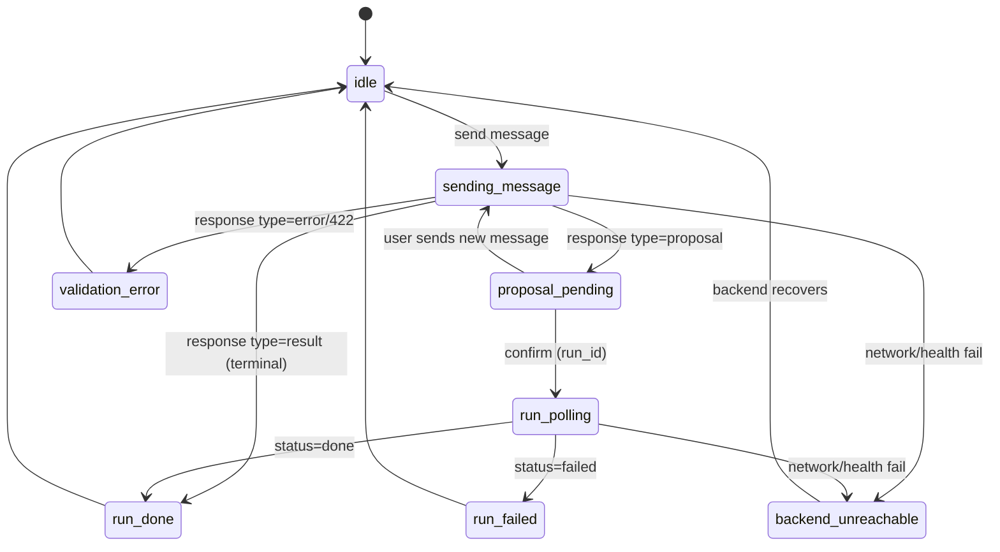

# UX Spec — gysi-ml

## 1. Ziel & Kontext

gysi-ml ist ein konversationeller ML‑Assistent, der natürliche Sprache in reproduzierbare, versionierte Pipeline‑Ausführungen übersetzt. Die UX muss die Kernidee sichtbar machen: **Das System macht Vorschläge, der Nutzer bestätigt aktiv, erst dann wird deterministisch ausgeführt**.

**Warum das wichtig ist:** In der Belegarbeit‑Demo zählt nicht nur ein „funktionierender Chat“, sondern *Nachvollziehbarkeit* (Spec‑Version, Steps, Run‑Status) und *Vertrauen* (keine stillen Runs, keine Halluzination als Handlung).

## 2. Ziele / Nicht‑Ziele (MVP)

### Ziele

- Chat‑Interaktion (User ↔ Assistant) gegen Backend unter `/v1/`.
- Proposal‑Darstellung (Steps + Parameter‑Summary) + expliziter Confirm‑CTA.
- Run‑Status‑Anzeige mit Polling bis terminal (`done|failed`).
- Ergebnis‑Summary (Status + Metriken, wenn vorhanden).
- Artefakt‑Links aus dem Backend abrufbar (öffnen in neuem Tab genügt).
- Status‑Panel: Spec‑Summary (Version + Steps) + letzter Run + letzte Artefakte.
- Robuste Fehler‑UX (Validation, Backend down, Run failed), ohne Deadends.

### Nicht‑Ziele (explizit out of scope)

- Voice (STT/TTS)
- Vollständiger Spec‑Editor (Roh‑JSON) oder komplexe Parameter‑Formulare
- Multi‑Session‑Management als eigene Seite
- Branching‑UI
- Dashboards / umfangreiche EDA‑Views

## 3. Personas & Nutzungskontext

- **Hannes (Developer/Builder):** iteriert schnell über Prompts, demonstriert Proposal→Confirm→Run und öffnet Artefakte.
- **Evaluator (Prof/WiMi):** prüft didaktisch/methodisch: Vorschlag statt Raten, Bestätigung vor Ausführung, reproduzierbare Runs.

**Device Context (bindend):** Desktop/Laptop, mouse/keyboard‑first.

## 4. Informationsarchitektur (Single Page)

### Layout

- **Hauptbereich:** Chat
  - Message‑Liste (chronologisch)
  - Composer (Textinput)
- **Nebenbereich:** Status‑Panel
  - Backend‑Status (erreichbar/nicht erreichbar)
  - Spec‑Summary (Version + Step‑Liste/Count)
  - Letzter Run (Status + wichtigste Metriken)
  - Letzte Artefakte (Linkliste)

### Navigationsprinzip

- Keine Zusatzseiten als Kern‑UX.
- Artefakte öffnen in neuem Tab.

## 5. Kern‑Interaktionen (Happy Path)

### 5.1 Session‑Start

- UI startet „leer aber bereit“.
- Session wird **automatisch** erstellt (spätestens beim ersten Senden), `session_id` wird im UI‑State gehalten.

### 5.2 Nachricht senden

- Send via Enter.
- Neue Zeile via Shift+Enter.
- Während Request: eindeutiger Ladezustand, kein doppeltes Senden.

### 5.3 Typed Responses (Rendering-Regeln)

Responses aus `POST /v1/sessions/{session_id}/messages` werden **typisiert** gerendert:

- `type: "proposal"`
  - Render als Proposal‑Card (siehe 6.2)
  - `confirmation_required: true` sichtbar machen
  - UI‑State: `proposal_pending`
- `type: "result"`
  - Render als Result‑Message (Metriken/Artefakte, wenn vorhanden)
  - UI‑State: `run_done` (oder direkt `idle`, wenn kein Run-Konzept gesendet wurde)
- `type: "error"`
  - Render als Error‑Message (kurz, verständlich, handlungsfähig)
  - UI‑State: `validation_error` oder generisch `idle` mit Error‑Banner

### 5.4 Confirm‑Flow

- CTA: **„Bestätigen & Ausführen“**.
- Klick ruft `POST /v1/sessions/{session_id}/confirm` auf.
- Button ist während Request disabled (UI‑seitige Idempotenz).

### 5.5 Run‑Polling

- Wenn Confirm `run_id` liefert und Run nicht terminal ist, UI pollt `GET /v1/sessions/{session_id}/runs/{run_id}`.
- Polling läuft nur bis `done|failed`.
- Backoff möglich (z.B. 1s → 2s → 4s …), ohne spürbare UI‑Last.
- UX‑Hinweis bei Long Run (z.B. nach ~2 Minuten): „Run dauert länger – wir aktualisieren weiter.“

### 5.6 Ergebnis & Artefakte

- Ergebnis‑Summary zeigt mindestens:
  - `status`
  - `metrics` (falls vorhanden)
  - `artifacts[]` (falls vorhanden)
- Artefakte als Linkliste (Label + Media‑Type, Öffnen in neuem Tab).

### 5.7 Proposal „ändern“

- Der Nutzer kann vor Confirm eine **neue Chat‑Nachricht senden**, um den Proposal zu modifizieren.
- Kein extra Formular.

## 6. UI‑Komponenten (MVP)

### 6.1 Chat Message Types

- User Message
- Assistant Message:
  - Proposal
  - Result
  - Error
  - (Optional) Info/Status‑Message, wenn hilfreich (z.B. „Run gestartet“)

### 6.2 Proposal‑Card (im Chat)

**Pflichtinhalte:**

- Titel/Label: „Vorschlag“ (klar als *nicht ausgeführt* markiert)
- Step‑Liste (Name + Parameter‑Summary)
- CTA: „Bestätigen & Ausführen“

**Verhalten:**

- Confirm disabled während Request
- Nach Confirm wird sichtbar, dass jetzt ein Run läuft (Statuswechsel)

### 6.3 Status‑Panel

**Sektionen (MVP):**

- Backend‑Indicator (Health‑Check):
  - erreichbar → normal
  - nicht erreichbar → `backend_unreachable` klar sichtbar
- Spec‑Summary:
  - Version (falls vorhanden)
  - Step‑Übersicht (Name + enabled oder zumindest Name)
- Letzter Run:
  - Status‑Chip (`queued|running|done|failed`)
  - wichtigste Metriken (Key/Value)
- Letzte Artefakte:
  - Linkliste

## 7. Zustände & State‑Machine

### 7.1 Must‑Have UI States

- `idle`
- `sending_message`
- `proposal_pending`
- `run_polling`
- `run_done`
- `run_failed`
- `validation_error`
- `backend_unreachable`

### 7.2 Transition‑Übersicht (vereinfacht)

## 8. Copy & Tonalität (Deutsch)

### Prinzipien

- Klar, kurz, nicht „AI‑mystisch“.
- Proposal immer als Vorschlag labeln („Vorschlag“, „Noch nicht ausgeführt“).
- Ergebnis immer als Fakten darstellen (Status, Metriken, Artefakte), ohne freies „Fabulieren“.

### Mikro‑Copy Beispiele (Guideline)

- Proposal: „Vorschlag (noch nicht ausgeführt)“
- Confirm CTA: „Bestätigen & Ausführen“
- Long Run: „Run dauert länger – wir aktualisieren weiter.“
- Backend down: „Backend nicht erreichbar. Bitte Backend starten oder URL prüfen.“

## 9. Fehlerfälle (UX‑Regeln)

### Validation Error

- Zeige eine verständliche Fehlermeldung (kurz) + Detail (optional aufklappbar).
- Nutzer kann sofort neu schreiben (kein blockierender Zustand).

### Backend Unreachable

- Deutlicher Zustand im Status‑Panel.
- Senden deaktivieren oder auf „Retry“ lenken (MVP‑Entscheidung: Senden deaktivieren, solange `health` failt).

### Run Failed

- Status `failed` sichtbar.
- Wenn Backend Ursache liefert (`error_message`/`detail`), kurz anzeigen.
- Artefakte ggf. leer; UI muss damit umgehen.

### Artifact Link Broken

- Link öffnet neuen Tab; bei Fehler: einfache Meldung im UI (z.B. „Artefakt konnte nicht geladen werden“).

## 10. Accessibility (Desktop)

- Vollständig per Tastatur bedienbar (Tab‑Order logisch: Composer → Send → Proposal CTA → Artefakte).
- Fokusmanagement:
  - nach Send bleibt Fokus im Composer
  - nach Confirm bleibt Fokus stabil (keine Sprünge)
- Statusänderungen (Run läuft/fertig) sollen nicht nur über Farbe kommuniziert werden.

## 11. Security/Robustness (Baseline)

- Message‑Content als Text rendern (keine HTML‑Interpretation) → XSS‑Risiko minimieren.
- Keine Secrets im Frontend.
- Fehlertexte nicht als Stacktraces anzeigen.

## 12. API Contract (UX‑relevant)

### Required Endpoints

- `POST /v1/sessions`
- `POST /v1/sessions/{session_id}/messages`
- `POST /v1/sessions/{session_id}/confirm`
- `GET /v1/sessions/{session_id}/runs/{run_id}`
- `GET /v1/artifacts/{artifact_id}`
- `GET /v1/health`

### Response Expectations (MVP)

- `/messages`:
  - `type: proposal | result | error`
  - Proposal: `confirmation_required: true`, menschenlesbare Step‑Liste
- `/confirm`:
  - `run_id`
- `/runs/{run_id}`:
  - `status: queued|running|done|failed`
  - optional `metrics` (key/value)
  - optional `artifacts[]` mit `artifact_id`, `label`, `media_type`, `href`

---

*Hinweis:* Diese UX‑Spec ist bewusst minimal und folgt strikt dem PRD‑Scope (Single Page, Proposal‑Confirm, Polling, Spec‑Summary).
